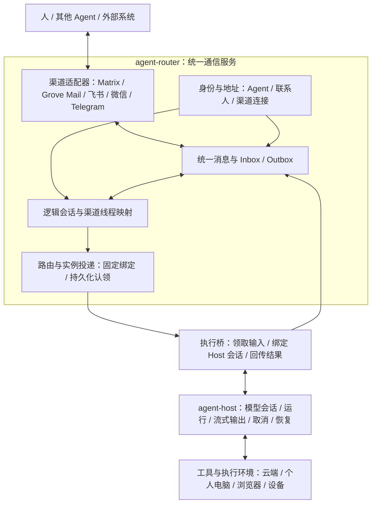

# 通信层逻辑架构

状态：多渠道媒体与交互链路已实现，真实账号联调待完成。日期：2026-10-12。

本文确定多渠道通信的模块边界。当前源码已接入渠道中立核心、五个渠道适配器和 Agent Host 执行桥，复用现有托管 Agent 与工作队列。配置与实际能力见[接入指南](../guides/personal-channels.md)；渠道能力与内核能力分别声明。

## 1. 总体决定

**把 agent-router 扩展成统一通信服务；agent-host 继续负责执行。** 邮件、飞书、微信、Matrix 等渠道通过适配器进入 Router，同一个 Agent 可以绑定多个地址。第一版按配置直连执行实例，不建设智能调度层。

这里的 Gateway 指对外接入入口。我们的渠道适配器和 Router 通信核心承担这部分职责；不需要另外创建一个名叫 Gateway 的服务，也不把 Host 合并进通信层。



这是逻辑拆分，不是五个微服务。第一版保留一个 Router 服务进程，复用已有 Matrix homeserver、Grove Mail 服务和 Host。执行桥运行在 Router 进程中，使用固定实例身份领取工作，通过 Host 公共 HTTP 接口执行；Host 可以位于云端或个人电脑，只需网络可达。

个人电脑和云机器都是执行环境。换执行地点不会改变 Agent 身份和渠道地址，但延续原来的模型会话需要保留对应 Host 与内核状态。

## 2. 五个通信模块的职责

| 模块 | 负责什么 | 持有的数据 |
| --- | --- | --- |
| 渠道适配器 | 接收平台事件、转换消息、读取附件、按平台格式发送、处理回执与重连 | 平台连接配置、凭据引用、同步游标、原生消息 ID 与发送回执 |
| 身份与地址 | 找到收件 Agent、识别发送人、把多个平台地址关联到同一主体 | Agent、联系人、渠道连接、地址绑定及绑定依据 |
| 统一消息与 Inbox/Outbox | 持久化收发、去重、记录处理状态、安排发送重试 | 消息、入站记录、出站记录、附件引用、来源与回复路径 |
| 会话映射 | 决定消息属于哪个逻辑会话，关联平台聊天线程 | 逻辑会话、渠道线程绑定、主会话配置 |
| 路由与实例投递 | 把逻辑会话交给既定执行实例，提供领取、进度、取消和结果回传 | 实例、会话归属、工作记录、认领与结果收据 |

通信核心不调用某个内核的私有会话 API。执行桥把通信工作转换成 Host 输入，保存逻辑会话到 Host 会话的绑定。Host 及其内核适配器保存真实模型会话和原生 transcript。

日历、文档、浏览器等业务服务仍通过产品工具接入 Host；它们产生的提醒或 webhook 可以作为入站事件。付款属于业务工具与支付服务，不进入通信消息发送协议。

## 3. 身份和地址怎么统一

**Router 的逻辑 `agentId` 是主身份；邮箱、Matrix MXID、飞书和微信账号是这个身份的地址。** 保留现有 managed Agent UUID，不把任何平台账号 ID 当作跨渠道 Agent ID。

三个关系需要分开：

- `Agent`：谁在提供服务，以及它属于哪个所有者。
- `Connection`：接入了哪个平台账号、机器人或邮箱，接收事件与发送消息需要使用哪份连接配置。
- `AddressBinding`：这个连接里的哪个地址属于哪个 Agent 或联系人。

同一个飞书机器人可能服务多个聊天，同一个邮箱也可能收到不同联系人邮件，因此连接、地址和对话不是一对一关系。一个平台事件可以按配置投递给多个 Agent，每份投递以 `agentId` 分别去重；默认只投给其绑定 Agent。

Grove Mail 的组织、pod、inbox 与 API 凭据仍由邮件服务管理；Router 保存邮箱连接和 Agent 的绑定。它们不需要合并成一张账号表。Router 现有 owner 登录仍依赖 Matrix，第一版可沿用；将来增加其他登录来源时，再建立稳定的所有者 ID 与平台账号关联。

联系人同理：只有用户确认或完成可验证的绑定，才能把邮箱、微信和飞书账号视为同一个人。显示名相同、邮件正文自称本人，都不能自动合并。平台身份认证和“此人是所有者”是两项不同的依据。

## 4. 四种会话标识

| 标识 | 含义 | 谁负责 |
| --- | --- | --- |
| `agentId` | 被联系的逻辑 Agent | Router 身份模块 |
| `channelThreadId` | 平台原生线程：Matrix room、飞书 chat/thread、邮件线程等 | 渠道适配器；必须带连接作用域 |
| `conversationId` | 产品里的连续对话，可关联多个渠道线程 | Router 会话模块 |
| `hostSessionId` | 实际执行所用的 Host 会话；Host 再绑定内核原生会话 | 执行桥保存映射，Host 管原生绑定 |

`runId` 是一次执行，`externalMessageId` 是平台上的一条消息，都不能代替 `conversationId`。Host 会话 ID 由执行桥生成，不直接使用邮箱地址或平台线程字符串。

第一版采用以下规则：

1. 同一所有者已确认绑定的私聊渠道，配置为同一个 Agent 主会话；跨渠道发言可以延续上下文。
2. 群聊、其他联系人和其他 Agent 的对话分别建立会话。群组里的本人发言也不会把整个群聊并入私人主会话。
3. 现有 Matrix/A2A context 保留原绑定，不因为新增个人主会话而自动合并；切换或重建主会话是显式操作。
4. 同一逻辑会话的普通输入按入站持久化顺序排队，一次执行一轮。跨渠道并发到达也不能同时写同一个 Host 会话。取消等控制消息走关联运行的控制路径。

例如，用户先在飞书说“帮我整理这个方案”，随后发邮件说“刚才的方案再加预算”：两条消息可以进入同一个 `conversationId` 和 Host 会话，但第一轮结果回复飞书，第二轮结果回复邮件。**共享上下文不等于向所有绑定渠道广播。**

## 5. 最小数据对象

以下是逻辑对象，不是已经发布的新 API，也不是新的 A2A 网络协议。

| 对象 | 最小信息 |
| --- | --- |
| `Connection` | ID、渠道、平台账号作用域、关联 Agent、配置和凭据引用、连接状态 |
| `AddressBinding` | 连接 ID、平台地址、主体 ID、绑定依据与状态 |
| `Conversation` | ID、Agent ID、参与主体/群组作用域、主会话标记、绑定实例 |
| `ThreadBinding` | 连接 ID、平台线程 ID、逻辑会话 ID |
| `MessageRecord` | ID、Agent ID、方向、消息/事件/控制类型、发送方与接收方、逻辑会话、内容、来源、回复路径 |
| `InboxEntry` | 来源去重键、消息 ID、接收顺序、处理状态、关联工作记录 |
| `OutboxEntry` | 消息 ID、明确目的地、稳定发送键、发送状态、平台回执、重试记录 |
| `ExecutionBinding` | Agent ID、逻辑会话 ID、绑定代次、实例 ID、Host 连接引用、runtime ID、Host 会话 ID |

`ExecutionBinding` 和运行关联账本由执行桥持久化；Router 保存投递实例归属，Host 保存自己的运行记录和原生会话绑定。

消息内容使用文本、附件和结构化数据等内容块；原始平台事件保留引用。来源记录包含连接、原生事件/消息/线程 ID、平台提供的身份依据和接收时间。附件保留可访问的资源引用，由适配器和执行桥按实际内核能力转换，不假定每个内核都能直接消费所有富媒体。

`replyRoute` 在接收消息时确定并随执行工作保存：包含连接、回复地址或线程、被回复的原生消息及必要的邮件引用信息。不能在执行结束时查询“用户最新使用的渠道”来决定回复位置。主动发消息时，调用方另外提供明确目的地。

来源标记描述内容来自哪里，不把所有外来文本一概解释成不可执行的数据。已识别用户的正常请求可以进入对话；正文中的自称身份或指令不能改写连接绑定、可信配置与系统指令。

A2A 渠道继续使用官方 Message、Task、Artifact；通信记录只补充内部来源和路由信息。普通聊天不需要对外伪装成 A2A Task，内部执行队列可以复用现有工作状态机制。

## 6. 入站、执行和出站

### 入站

```text
平台事件
  → 适配器校验与解析
  → 解析收件 Agent、发送方、逻辑会话和 replyRoute
  → 持久化原始来源、MessageRecord、InboxEntry 与游标
  → 向平台确认接收
  → 按会话顺序生成执行工作
  → 固定实例领取
```

平台回调和同步事件按至少一次到达处理。去重键包含连接作用域、平台事件 ID 和收件 Agent；不能只用消息文本。同一个外部事件 ID 对应不同内容时应记录冲突，不当成新的请求执行。游标推进或回调成功确认必须发生在收件记录持久化之后。

补拉历史只恢复通信记录，不自动重跑历史请求。既有执行账本负责判断是否已接收、已执行或仍待处理。邮件连接保留邮箱生命周期作用域；旧游标失效时显式对账，不能从空游标开始把旧邮件当成新任务。

### 执行直连

```text
Inbox 工作
  → 路由到已绑定实例
  → 执行桥解析或创建 ExecutionBinding
  → 通过 AgentHostClient 提交一轮输入
  → 关联 runId，观察输出 / 提问 / 取消 / 终态
  → 持久化结果与发送意图
  → Outbox
```

第一版复用持久化认领与会话固定实例。默认实例由配置指定，不根据意图选择模型、机器或执行者。原有会话固定实例规则仍有效；第一版不引入认领过期、自动换机或崩溃接管。

执行桥使用 Host 公共接口，选择已经配置好的 `runtimeId`，并把稳定指令、当轮用户输入和产品上下文分别传入。需要用户回答的原生提问保留结构和运行关联，可由渠道卡片或管理界面承接。原生工具执行和内核控制仍由 Host 处理。

执行桥负责输入/输出关联和自己的恢复账本，不复制内核 transcript。Host 当前 HTTP 服务使用一个可信所有者的访问令牌，因此不同所有者应配置各自的 Host 实例/状态或受控执行端；渠道账号不会直接拿到 Host 令牌。

恢复时重新观察已有运行和结果，不把通信重试变成模型重跑。Host 提交请求在响应丢失时可能无法确认是否已启动；桥接账本本身不能保证远端提交恰好一次。无法找到可靠关联的运行时记录“提交结果未知”，不盲目再提交。若后续需要自动闭合此恢复窗口，应在 Host 公共接口增加可验证的幂等提交机制。

### 出站

```text
执行结果或明确的发送请求
  → 生成携带 replyRoute / 明确目的地的消息
  → 持久化 Outbox
  → 适配器按渠道能力转换并提交
  → 保存平台消息 ID 和发送状态
  → 接收后续送达 / 已读回执（平台支持时）
```

结果落库与创建对应出站意图在同一 Router 状态事务里完成；重复结果回传返回已有收据。发送失败只重试 Outbox，不重新启动 Host。已有收发规则在相应路径调用，作为内部规则保留，不单独拆出一个“出站闸门”服务。

发送状态区分“排队”“提交中”“平台已接受”“确认失败”和“结果未知”；平台接受不等于对方收到或读到。支持幂等键的渠道使用稳定键重试。缺少平台幂等或可验证对账能力时，网络中断后的不确定发送不能无条件重发。

第一版回传最终文字结果，后续可按渠道能力增加流式更新。自身消息和平台回执不成为新的用户输入；编辑事件不自动重新执行，本版不实现通用修订历史。长度限制与原生线程由适配器处理；附件下载和卡片尚未接入。

## 7. 服务连接和渠道能力

每个适配器提供接收/同步、消息转换、附件读取、发送、状态对账和能力描述。核心不接触 Matrix room API、邮件 IMAP UID 或飞书/微信 SDK 对象。

能力描述至少包含：能否接收、能否主动发送、是否支持线程和回复、是否能编辑消息、内容类型与大小限制、幂等/对账能力、送达/已读回执。能力来自具体连接与平台协议，不把所有 IM 当作相同能力。

| 接入 | 方式与边界 |
| --- | --- |
| Matrix | 将现有 Matrix 协议、同步、房间与原生账号数据留在适配器；A2A 行为与普通聊天行为分别保留 |
| Grove Mail | 现有邮箱持久化事件 API 轮询收信、原消息 reply API 回复；邮件服务管理邮箱与邮件协议 |
| 飞书 | 官方 Channel 1.74.0 长连接与扫码应用配置；官方 CLI 1.0.97 负责个人 Device Flow、刷新和业务工具 |
| Telegram | grammY 1.46.0，Router 管理持久化 polling 游标与 topic 路由 |
| 微信 | 腾讯插件 2.4.9 的独立协议和扫码实现，保存 uint64 消息 ID、收信游标与逐条 context_token |
| Webhook / 定时器 / 推送通知 | 预留扩展，本版未实现 |

Grove Mail 的 WebSocket 是实时通知，断线恢复仍需持久化事件 API 对账；首个邮件适配器优先使用可回放的 API/SSE。邮件回复使用邮件服务已有的收件人和引用头逻辑，群发或 reply-all 是显式发送模式。

个人资源连接与聊天通道分别实现。飞书连接在 `src/services/feishu/` 管理应用到个人的授权，使用官方 CLI 独立配置和 Linux 凭据目录；Host 通过公开 product tool 契约调用它。聊天继续使用 bot 身份，业务工具固定使用绑定的 user 身份。工具按 run/call ID 保存执行回执，进程中断不重复写操作；官方 scope、应用权限和确认错误保留原有含义。

这不意味着每个渠道都需要个人 OAuth：Telegram 使用 Bot token，微信使用腾讯 iLink bot 配对，Grove Mail 使用 inbox API key，Matrix 使用已有托管 AS 身份。它们当前提供对话入口；个人 Telegram/微信全账号与 Gmail/Outlook 数据授权尚未实现。

## 8. 与现有实现的对应

| 已有实现 | 可以复用 | 需要调整 |
| --- | --- | --- |
| [managed Agent 与实例注册](../../src/matrix/managed.ts)、[现有身份决策](decisions/0004-managed-agents.md) | Agent UUID、所有者与实例关系、实例凭据、会话固定实例 | 将逻辑 Agent 与 Matrix 地址分开；平台连接通过绑定挂到 Agent |
| [Matrix Application Inbox](../../src/matrix/application-service.ts) | 持久化平台事务、去重和按 Agent 投递 | 保留为 Matrix 入口，接入渠道中立 Inbox |
| [Matrix Connector](../../src/matrix/connector.ts)、[Store](../../src/communication/store.ts) | 收发状态事务、稳定发送键、游标、SQLite 存储原语 | 通用 Store 已抽到通信目录，Matrix 保留兼容导出；普通聊天 hook 与原游标共用事务 |
| [工作队列与认领](../../src/matrix/cli-work.ts) | 工作状态、修订、认领、结果收据、取消和上下文串行 | 输入来源改为渠道中立引用，执行绑定以逻辑会话为键 |
| [Codex worker](../../examples/codex-worker/worker.mjs) | Router 领取与回传的运行方式、执行账本经验 | 增加 Host worker，使用 Host 公共接口承接内核，兼容现有 worker |
| [Grove Mail 适配器](../../src/channels/grove-mail.ts) | 事件回放、webhook、邮箱作用域、幂等发送、回复与不确定状态 | 新增 Router 邮件适配器，保存游标和邮箱到 Agent 的绑定 |
| [Agent Host 公共边界](https://github.com/Olorinm/agent-host/blob/main/docs/scope.md)、[HTTP 服务](https://github.com/Olorinm/agent-host/blob/main/docs/http-service.md) | 内核集成、原生会话绑定、运行与输出、取消和恢复 | 新增执行桥和绑定账本；Host 不承担渠道与联系人业务 |

当前已实现文字、媒体与原生交互闭环：显式配置的聊天入口进入统一队列，由固定 Host runtime 执行，最终结果回复原渠道。未配置个人聊天的 Agent 保持原 `say` / `send` 行为。协议测试通过不等于平台账号已经上线，真实联调仍需要渠道凭据和可用的 Host runtime。

现有 [Matrix 通信决策](decisions/0002-matrix-communication.md) 和 [Go CLI 决策](decisions/0003-go-cli.md) 继续描述当前实现。本文规划的是增量扩展，保留现有 CLI、A2A 语义、Matrix 原生同步与已有任务状态，不恢复已经退役的自定义 Router 协议。

## 9. 当前实现边界

1. 通信核心复用 Router SQLite，按逻辑 Agent 隔离。保留已有 Matrix 状态，不重放历史认领；工作队列和 Store 抽到中立目录，原导入路径兼容。
2. 执行桥绑定固定 Host runtime 和实例，保存提交、已知 run ID 和结果；执行结果未知时提供人工核对接口，不重复执行。
3. Matrix、Grove Mail、飞书、Telegram 和微信使用同一收信与回复契约。Matrix 沿用原同步进程，邮件沿用现有服务，其他三者按选定实现接入。
4. 附件双向传输、图片原生输入、渠道支持的流式输出、按钮回答、引用和原生控制已接通。微信限 iLink 私聊，Matrix 不支持加密房间；独立 worker 发布留待后续。

当前目录边界：

```text
src/communication/    身份地址、统一消息、会话、Inbox/Outbox
src/channels/         matrix、grove-mail、feishu、telegram、weixin
src/execution/        实例路由、工作投递与 Host 执行桥
src/service/          HTTP/CLI 兼容入口、配置与服务装配
src/services/feishu/  官方应用配置、个人授权和 CLI 工具桥
```

暂不建设智能调度、独立记忆服务、设备平台或管理后台。工具和执行环境继续沿用 Host 的产品接入边界；通信文档不扩展成整套个人 Agent 产品方案。

## 10. 第一版完成标准

以下场景已通过自动化协议/恢复测试；真实渠道账号上线仍需联调：

- 现有 Matrix/A2A 的发送、领取、回复、取消与查询保持原行为；普通 `say` 的执行行为只有在显式启用个人聊天入口后改变。
- 同一所有者跨渠道连续发言，映射到同一 Host session；每轮结果回复保存的来源路径，其他渠道不会收到广播。
- 同一主会话的并发输入串行处理；群聊和其他联系人不进入所有者私人会话。
- 平台重复事件只生成一份入站工作；回放历史不会重跑模型；离线后恢复可以继续处理未完成的入站记录。
- 自己发出的消息及平台回执不会再次触发执行，消息编辑不会悄悄重跑上一轮。
- 结果已落库而发送尚未完成时，重启只恢复 Outbox；平台接受或结果未知被准确记录，不重复执行原任务。
- 保存实例、执行桥和 Host 状态后可以延续原生会话；状态丢失或运行结果未知时明确报告，不能假装已经恢复。

另已用实际 Agent Host 服务与 Codex 协议测试程序验证托管 Router 装配、连续两轮、原生提问与 Matrix 原聊天回复，以及实际 Host HTTP broker 与飞书 CLI 测试替身的工具往返。飞书由官方 Channel 管理事件确认，业务异常不能要求平台重投；本版不承诺端到端无损收信，详见接入指南。
